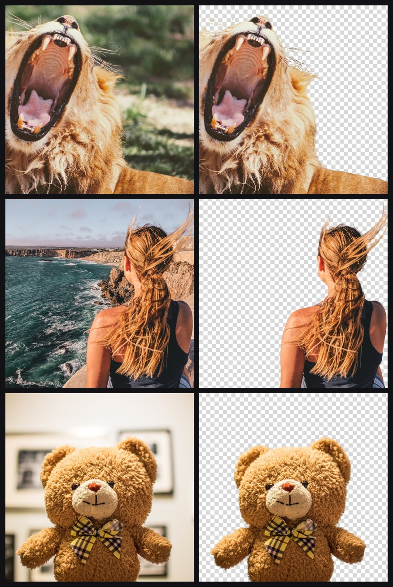

# bgremove

Background remover for photos and videos. Runs on CPU, no GPU needed. This is what runs behind https://justsal.xyz/bgremove.

```
pip install -r requirements.txt
python bgremove.py photo.jpg
python bgremove.py clip.mp4
```

Output is `photo-no-bg.png` (transparent) and `clip-no-bg.mp4` (green background). Video needs ffmpeg. The first run downloads about 1.2 GB of models.

```
python bgremove.py photo.jpg --bg ffffff                 # white background
python bgremove.py photo.jpg --model isnet-general-use   # low RAM machines, rougher result
python bgremove.py clip.mp4 --bg transparent             # WebM with alpha, iPhones can't play it
python bgremove.py clip.mp4 -o out.mp4
```

<picture>
  <source media="(min-width: 768px)" srcset="study/cut-wide.jpg">
  
</picture>

## Requirements

| Model | RAM | 12 MP photo |
|---|---|---|
| default (birefnet-general) | 16 GB | 15 s |
| `--model birefnet-general-lite` | 12 GB | 11 s |
| `--model isnet-general-use` | 4 GB | 4.5 s |

4 cores is enough, more than 8 doesn't help. Video runs at about 3 frames per second on 24 threads. Not tested on a GPU.

## Model comparison

10 models tested on 100 photos from AIM-500, which come with hand-made masks. BiRefNet is off by 0.6%. ISNet, the best of the fast models, is off by 3.4%. Full results are in [study](study/).

## Todo

- [ ] GPU numbers
- [ ] Transparent video that plays on iPhones
- [ ] The HTTP worker used on the site

## Credits

[rembg](https://github.com/danielgatis/rembg), [BiRefNet](https://github.com/ZhengPeng7/BiRefNet), [DIS / ISNet](https://github.com/xuebinqin/DIS), [U-2-Net](https://github.com/xuebinqin/U-2-Net), [pymatting](https://github.com/pymatting/pymatting), [face-parsing](https://github.com/yakhyo/face-parsing), [YuNet](https://github.com/opencv/opencv_zoo). Test photos and the pictures above are from [AIM-500](https://github.com/JizhiziLi/AIM).
