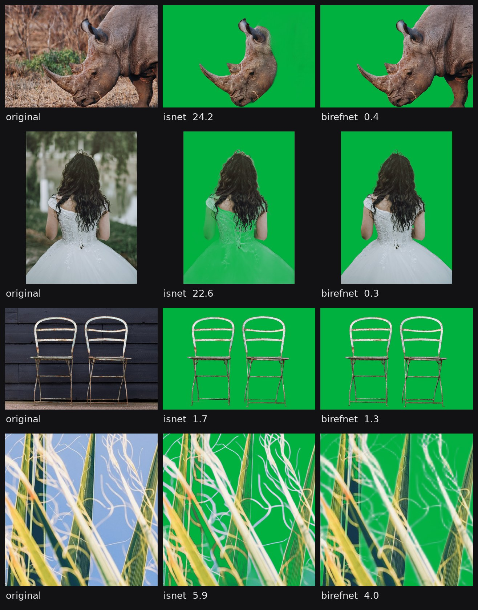

# Results

Measured on one machine: Ryzen 9 7900 (12 cores, 24 threads), 64 GB RAM, no GPU, Python 3.12, rembg 2.0.85, onnxruntime 1.31. The machine was running other things, so timings are within about 10%.

## Speed

Seconds per photo for the model alone, by thread count:

| threads | 1 | 2 | 4 | 8 | 16 | 24 |
|---|---|---|---|---|---|---|
| birefnet | 27.3 | 14.0 | 8.8 | 6.7 | 7.0 | 9.1 |
| birefnet lite | 10.5 | 6.1 | 4.5 | 3.9 | 4.0 | 4.9 |
| isnet | 2.6 | 1.2 | 0.65 | 0.41 | 0.42 | 0.52 |
| u2netp | 0.38 | 0.19 | 0.12 | 0.09 | 0.09 | 0.15 |

8 threads is the fastest and 24 is slower than 8, so the script caps photos at 8. BiRefNet uses about 14 GB of RAM at any thread count.

Video: 2.9 frames per second at 720p on 24 threads, about 2 GB of RAM per 4 cores.

## Accuracy

100 photos from [AIM-500](https://github.com/JizhiziLi/AIM) (people, animals, furniture, plants, toys, glass), each with a hand-made mask. BiRefNet's general weights were trained on the test splits of DUTS, HRSOD and P3M, so those can't be used to score it. AIM-500 is not in its training list. The training data of bria-rmbg and birefnet-massive is not published.

- Error: mean difference between predicted and true alpha over all pixels.
- Edge error: the same, only near the outline.
- Worst: error on the single worst photo.

| model | error % | edge error % | worst % | sec per photo | ram | download | licence |
|---|---|---|---|---|---|---|---|
| birefnet-portrait | 0.56 | 3.8 | 4.8 | 9.1 | 13.6 GB | 973 MB | MIT |
| **birefnet-general** | 0.62 | 4.0 | 4.0 | 9.2 | 13.6 GB | 973 MB | MIT |
| bria-rmbg | 0.68 | 4.6 | 7.1 | 9.2 | 13.5 GB | 1024 MB | non commercial |
| birefnet-general-lite | 0.79 | 5.0 | 6.8 | 5.5 | 12.1 GB | 224 MB | MIT |
| birefnet-massive | 2.39 | 9.9 | 32.8 | 9.1 | 13.7 GB | 973 MB | MIT |
| **isnet-general-use** | 3.42 | 11.2 | 24.2 | 0.56 | 1.7 GB | 179 MB | Apache 2.0 |
| u2net | 3.99 | 13.4 | 24.2 | 0.26 | 1.1 GB | 176 MB | Apache 2.0 |
| silueta | 4.29 | 13.8 | 24.4 | 0.57 | 0.8 GB | 44 MB | Apache 2.0 |
| u2netp | 4.94 | 14.3 | 40.5 | 0.09 | 0.7 GB | 5 MB | Apache 2.0 |
| u2net_human_seg | 5.60 | 19.2 | 38.7 | 0.25 | 1.1 GB | 176 MB | Apache 2.0 |

Bold marks the models this repo uses. Time and RAM in this table are at 24 threads.

<picture>
  <source media="(min-width: 768px)" srcset="models-wide.jpg">
  
</picture>

The number under each image is its error. These are the photos where the models disagree most.

- The top three (birefnet-portrait, birefnet-general, bria-rmbg) are within noise of each other.
- bria-rmbg is non-commercial.
- birefnet-general-lite is slightly worse (+0.18) and 40% faster, but still needs 12 GB.
- birefnet-massive is worse than birefnet-general on all 100 photos.
- isnet and u2net have 5 to 6 times the error. They drop whole parts of the subject, not just edge detail.
- Transparent objects are the hardest category for every model.

Error by category:

| model | animal (40) | portrait (20) | plant (15) | furniture (9) | toy (7) | transparent (7) | fruit (2) |
|---|---|---|---|---|---|---|---|
| birefnet-portrait | 0.38 | 0.31 | 0.69 | 0.66 | 0.53 | 2.01 | 0.42 |
| birefnet-general | 0.47 | 0.35 | 0.74 | 0.66 | 0.63 | 1.87 | 0.52 |
| bria-rmbg | 0.49 | 0.37 | 0.75 | 0.71 | 0.63 | 2.48 | 0.62 |
| birefnet-general-lite | 0.61 | 0.39 | 0.87 | 0.73 | 0.67 | 3.05 | 0.59 |
| birefnet-massive | 1.99 | 1.71 | 1.24 | 0.77 | 0.92 | 13.08 | 0.76 |
| isnet-general-use | 3.77 | 3.67 | 1.71 | 1.09 | 1.26 | 10.25 | 0.68 |
| u2net | 3.42 | 4.81 | 3.75 | 3.00 | 1.50 | 10.05 | 1.01 |
| silueta | 3.91 | 5.28 | 3.78 | 3.27 | 1.56 | 9.67 | 1.21 |
| u2netp | 5.82 | 5.20 | 3.28 | 2.71 | 1.41 | 10.09 | 1.44 |
| u2net_human_seg | 4.07 | 1.83 | 6.64 | 15.44 | 9.63 | 7.11 | 2.53 |

Confidence intervals come from a bootstrap over the 100 photos (10000 resamples), printed by `bench/score.py`. Per-photo numbers are in [results.json](results.json).

## Post-processing

- **Levels.** Alpha below 8 goes to 0 and above 245 to 255. BiRefNet 0.62 -> 0.53, ISNet 3.42 -> 3.24.
- **Edge colour.** pymatting estimates the foreground colour of semi-transparent edge pixels, which removes the old background's tint. Not scored, the test set has no true colours.
- **Glasses.** Models treat lenses as solid. `glasses.py` clears lens pixels that fall outside the face and touch removed background. Not scored, AIM-500 hides faces.
- **Veto (video).** ISNet keeps floor reflections on some frames, which flickers. A u2netp mask is used to reject regions it doesn't see. On 8 frames from a flickering clip, with BiRefNet as reference:

| | kept by mistake % |
|---|---|
| isnet alone | 6.0 |
| with veto | 0.8 |

The veto is skipped when it would remove more than 30% of the mask. It still costs accuracy on stills (3.24 -> 3.49), so `--no-veto` turns it off.

## Video threading

Model copies x threads each, frames per second at 720p:

| copies x threads | isnet | isnet + veto |
|---|---|---|
| 1 x 24 | 1.9 | 1.5 |
| 2 x 12 | 2.6 | 2.2 |
| 4 x 6 | 3.2 | 2.7 |
| 6 x 4 | 3.4 | 2.9 |
| 8 x 3 | 3.5 | 3.0 |
| 12 x 2 | 3.4 | 3.0 |

The script runs one copy per 4 cores.

## Reproduce

```
pip install pyarrow
# test-00000-of-00001.parquet from https://huggingface.co/datasets/nobg/AIM-500
python bench/data.py test-00000-of-00001.parquet data 100
sh bench/run.sh data        # about 2 hours, wants 16 GB free
python bench/score.py data
python bench/sheet.py data study
python bench/veto.py some/folder/of/frames
```
